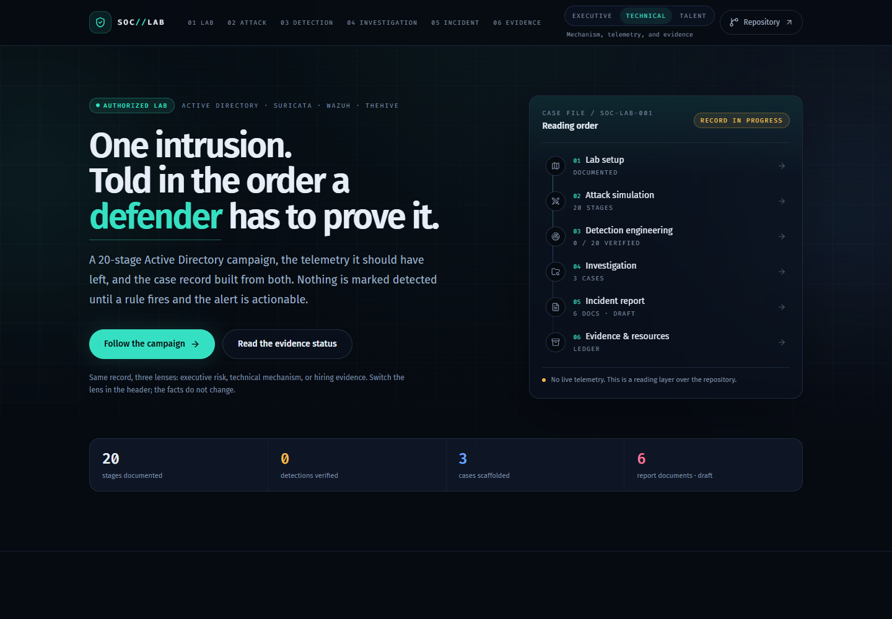

# SOC Lab reading layer

The site at <https://soc-lab.eclipsemanic.me/> is a narrative front door to the repository. It is a six-act story: the lab, the build, the attack, the signal, the case, and the record.

The site now covers all six acts: the lab, the build, the attack, the signal, the case, and the record. The attack ledger uses the 20 documented stages; the detection chapter shows telemetry capability without claiming validated coverage; the case and report chapters stay explicitly draft or scaffolded.

The Markdown, logs, cases, and report files are authoritative. This app is a reading layer over them.



## Stack

- React 19 and TypeScript
- Vite 8
- Tailwind CSS 4 with a small set of semantic design tokens
- shadcn/ui-style Radix primitives
- Motion for scroll-driven scenes, entrances, and dialog animation
- Lucide icons

## Local development

```powershell
cd Site
npm ci
npm run dev
```

Useful checks:

```powershell
npm run check:data
npm run build
npm run preview
```

`check:data` verifies the content invariants: 20 stages, 20 gap IDs, and 6 report documents. `build` runs the TypeScript project build before the Vite production build.

## Source map

| Path | Purpose |
|---|---|
| `src/data.ts` | Stage, chapter, case, report, evidence, and status data |
| `src/components/` | Page sections, navigation, handoffs, and UI primitives |
| `src/components/story/` | Cold open, all six acts, boundary interlude, and story shell |
| `src/context/lens-context.tsx` | Executive / Technical / Talent reading lens (legacy chapters) |
| `src/index.css` | Tailwind theme tokens, base styles, and shared utilities |
| `scripts/check-data.mjs` | Content integrity checks |
| `public/` | CNAME, robots.txt, preview image, and architecture asset |
| `dist/` | Generated production output; do not edit by hand |

## Content rules

- Keep all 20 stages at `Not tested` until a rule fires for the right reason and the alert is actionable.
- Keep `verifiedCount` derived from stage status; do not hardcode a detection count.
- Treat a missing artifact as a documented gap, not as proof.
- Attack and alert screenshots are published as captured from the isolated lab.
- Do not silently rewrite the architecture PNG. Its gateway label is `.1`; the authoritative network record says `.150`.
- Record placeholders (`DG-01` through `DG-20`) stay reserved until validated evidence exists.
- The report package is a draft. Confirmed facts, hypotheses, and recommended actions remain separate.

## Deployment

The workflow at `../.github/workflows/pages.yml` sets up Node 22, runs `npm ci`, `npm run check:data`, and `npm run build`, then uploads `Site/dist` to GitHub Pages.

In GitHub, set **Settings → Pages → Build and deployment → Source** to **GitHub Actions**. The custom domain is carried by `public/CNAME`.

Live site: <https://soc-lab.eclipsemanic.me/>
